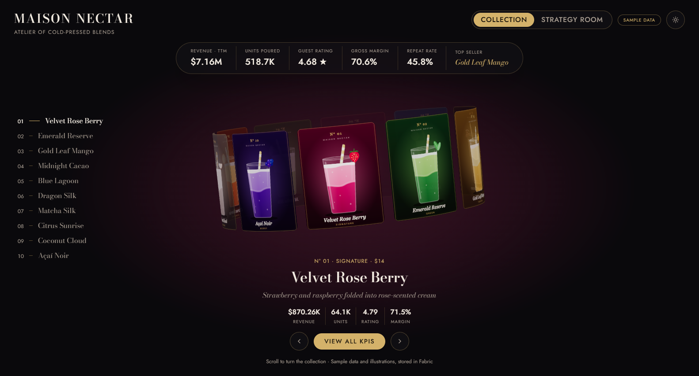
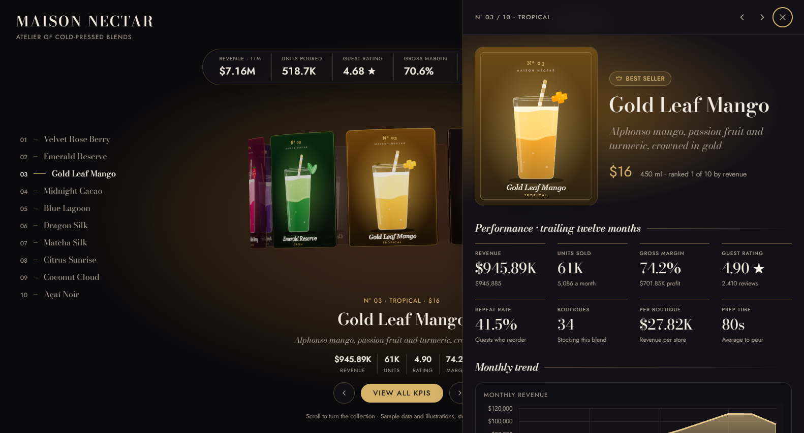
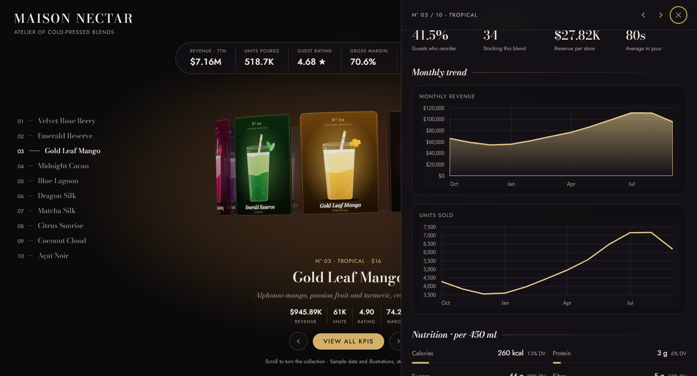
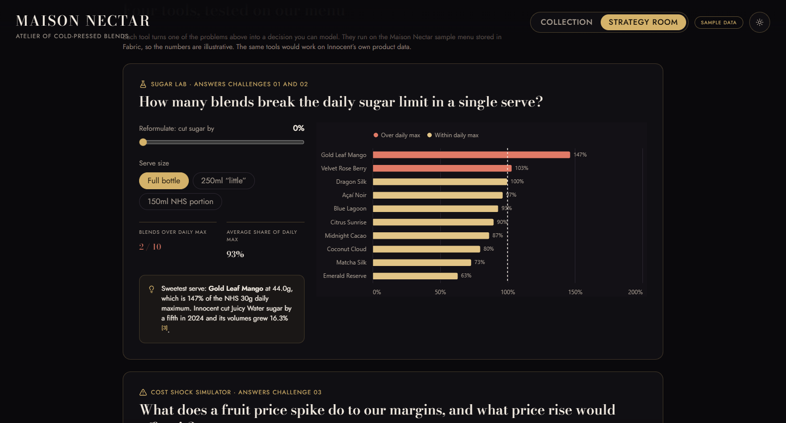
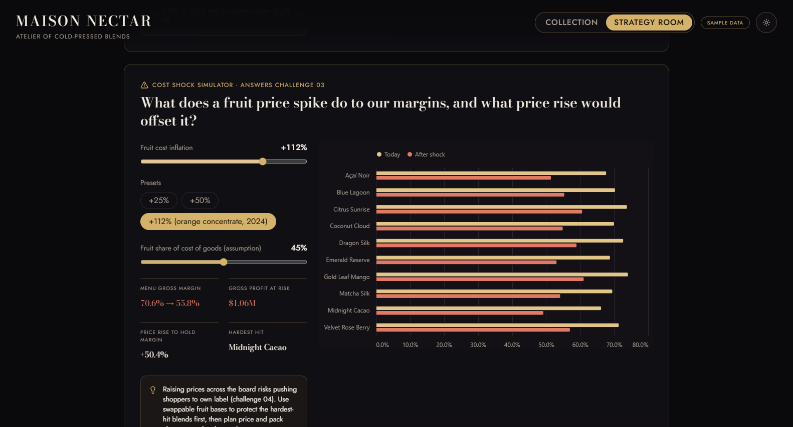
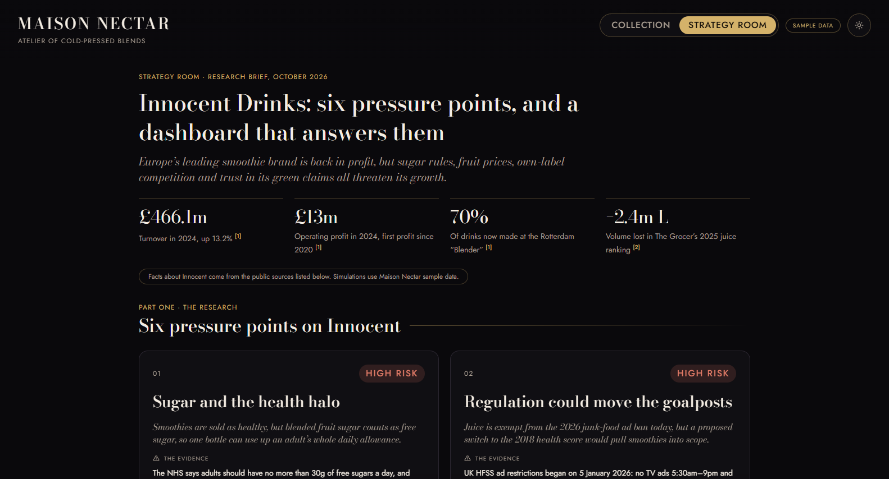

# Maison Nectar

**A 3D smoothie showcase and strategy dashboard, built on Microsoft Fabric.**

A luxury smoothie brand's menu as a rotating 3D gallery. Every blend opens into a full KPI view with trend charts and nutrition. A second "Strategy room" turns researched problems facing Innocent Drinks into four interactive what-if tools, all fed by a database that lives in Fabric.

> 🎥 **Demo video:** [Watch the walkthrough](https://drive.google.com/file/d/1UCEwISFdPFn9gnD9rQgT_depnFH9-Sfv/view?usp=drive_link)



## Why I built it

I wanted a portfolio project that goes past a pretty front end: real data in a real backend, real analytics, and a business point of view. So I picked a famous smoothie brand, researched what threatens it (sugar rules, fruit prices, own-label competition), and built a dashboard that lets you test answers to those problems.

Maison Nectar is a **fictional** brand with **sample data**. It stands in for the kind of product data a brand like Innocent would have. The facts about Innocent in the Strategy room come from public sources, each linked in the app.

## What it does

### Collection
- **3D ring of cards** in React Three Fiber. Scroll, swipe, use the arrow keys or the buttons to turn it. It settles on the nearest card, and hovering enlarges one.
- **KPI strip** across the whole menu: revenue, units, guest rating, gross margin, repeat rate and top seller.
- **KPI panel per smoothie:** eight KPI tiles, monthly revenue and units charts, nutrition against daily reference values, and ingredients.
- **Illustrated menu cards**, drawn in code as SVG from each smoothie's stored colours and garnish.
- Light and dark themes, keyboard navigation, and a phone-friendly layout.

| KPI panel | Monthly charts |
| --- | --- |
|  |  |

### Strategy room
Six pressure points on Innocent Drinks, each with sourced evidence and a proposed fix:

1. **Sugar and the health halo:** the NHS counts smoothie sugar as free sugar (30g a day for adults).
2. **Regulation could move the goalposts:** the 2026 junk-food ad ban exempts juice today, but a proposed health score would pull smoothies in.
3. **Fruit cost shocks:** European orange concentrate rose 112% in a year (June 2024).
4. **Own-label trade-down:** juice and smoothie volumes fell 52.7m litres in 2024.
5. **Running a £200m factory:** the Rotterdam "Blender" now makes 70% of Innocent's drinks.
6. **Sustainability credibility:** a 2022 advertising-regulator ruling on green claims.

Four of them come with a working tool that runs on the sample menu:

| Tool | The question it answers |
| --- | --- |
| **Sugar Lab** | How many blends break the daily sugar limit, and what does a recipe cut or a smaller bottle change? |
| **Cost Shock Simulator** | What does a fruit price spike do to margins, and what price rise would offset it? |
| **Seasonality Planner** | How uneven is demand through the year, and which blends fill the winter gap? |
| **Trade-down watchlist** | Which blends are most likely to lose shoppers to cheaper own-label products? |

| Sugar Lab | Cost Shock Simulator |
| --- | --- |
|  |  |



## Tech stack

- **Front end:** React 19, TypeScript, Vite, Tailwind CSS v4, Framer Motion
- **3D:** three.js, React Three Fiber, drei
- **Charts:** Vega-Lite through Microsoft's Fabric visuals components
- **Backend and data:** Microsoft Fabric app backend (Rayfin): a SQL database defined as decorated TypeScript entities, served over GraphQL
- **Auth:** Fabric single sign-on; nothing renders until the user is signed in
- **Quality:** typecheck, ESLint, 63 Vitest tests, and a Vega-Lite spec validator

## Data model

| Entity | Purpose |
| --- | --- |
| `Smoothie` | One row per blend: recipe, nutrition, price, and trailing-twelve-month KPIs |
| `SmoothieMonthly` | One row per blend per month: units, revenue and rating, for the trend charts |

Everyone signed in can read the menu. Only the person who created a row can change or delete it, enforced by row policies on the server. The entity classes are in [`packages/data/src`](packages/data/src), with browser-safe types in [`packages/shared/src`](packages/shared/src).

## Getting started

You need Node.js and access to a Microsoft Fabric workspace that can host Fabric apps. Install the dependencies, then follow the Rayfin deployment guide (installed with the project at `node_modules/@microsoft/rayfin-guide/assets/docs/app-backend/deploy.md`) for first-time setup:

```sh
npm install
npx rayfin login                     # sign in with your Fabric account
npx rayfin up -w "<your workspace>"  # create the app, apply the schema, deploy
npm run dev                          # local dev server at http://localhost:5173
npm run seed                         # in a second terminal: load the sample menu
```

`npm run seed` signs in as you through the dev server (no password), clears the rows you seeded before, and loads 10 smoothies with 12 months of sales each. The numbers are generated from a fixed seed, so every run gives the same data ([`scripts/seed/smoothie-menu.mjs`](scripts/seed/smoothie-menu.mjs)).

### Checks

```sh
npm run typecheck
npm run build
npm run lint
npm test
npm run validate:visual
```

### Deploy

```sh
npx rayfin up -w "<your workspace>"
```

The deployed app is private: visitors must sign in with a Fabric account that has access to the workspace.

## Project structure

```text
packages/
  frontend/src/
    App.tsx                  # Collection / Strategy room views
    components/
      showcase/              # 3D ring and card geometry
      menu/                  # KPI strip, KPI panel, charts, SVG artwork
      strategy/              # Strategy room page and its charts
    data/
      menu.ts                # Fabric queries and formatting
      strategy.ts            # What-if calculations (unit tested)
      innocent-research.ts   # Research, evidence and source links
  data/src/                  # Database entities
  shared/src/                # Browser-safe contracts
rayfin/rayfin.yml            # Fabric services configuration
scripts/                     # Sample-data seeding
```

## Sources

Research compiled 14 October 2026. Each claim in the app links to its source.

- Grocery Gazette: [Innocent Drinks returned to profit in 2024](https://www.grocerygazette.co.uk/2025/12/10/innocent-drinks-returned-to-profit-in-2024/)
- The Grocer: [Juices & smoothies 2025](https://www.thegrocer.co.uk/rankings/soft-drinks-juices-and-smoothies-2025-functional-juice-shots-fuel-growth/712957.article) and [2024](https://www.thegrocer.co.uk/analysis-and-features/soft-drinks-juices-and-smoothies-2024-juices-dry-up-as-own-label-prices-rocket/698923.article)
- The Grocer: [Innocent losses soar as £200m factory needs more investment](https://www.thegrocer.co.uk/news/innocent-losses-soar-as-200m-factory-needs-more-investment/687275.article)
- The Grocer: [Innocent facing bans under new government health score](https://www.thegrocer.co.uk/news/doritos-belvita-and-innocent-facing-bans-under-new-government-health-score/713972.article)
- IGD: [HFSS advertising ban comes into force](https://www.igd.com/articles/hfss-advertising-ban-comes-into-force/72216)
- NHS: [Sugar: the facts](https://www.nhs.uk/live-well/eat-well/food-types/how-does-sugar-in-our-diet-affect-our-health/)
- FreshPlaza: [Orange juice prices reach new record high](https://www.freshplaza.com/north-america/article/9642059/orange-juice-prices-reach-new-record-high/)
- Grocery Gazette: [Innocent ad "misleads" consumers over eco claims, ASA rules](https://www.grocerygazette.co.uk/2022/02/23/innocent-ad-misleads-consumers-over-eco-claims-asa-rules/)
- Innocent Drinks: [Why the NPM 2018 matters to innocent](https://www.innocentdrinks.co.uk/content/dam/innocent/gb/en/things-we-make/nutrition/nutrition-new-vi/why%20the%20NPM%202018%20matters%20to%20innocent.pdf)
- Raconteur: [What happens when ethical trailblazers are acquired by multinationals](https://raconteur.net/sustainability/what-happens-when-ethical-trailblazers-are-acquired-by-multinationals)

## Notes and limits

- **Sample data.** Maison Nectar is fictional. Its sales, margins and ratings are generated, and the simulators run on them, not on Innocent's real numbers. One input, fruit's share of cost of goods (default 45%), is an adjustable assumption and is labelled as one.
- **Not affiliated.** This project has no connection with Innocent Drinks or The Coca-Cola Company. Names are used only to describe the public research.
- **Dated research.** Figures reflect the cited sources as of October 2026. Regulation in particular is still a proposal.

## Credits and license

- The 3D card ring is inspired by the pmndrs "Cards with border radius" example (MIT). The bent-plane card geometry is adapted from it.
- Built from Microsoft's Fabric app starter template. Its source files keep their original copyright headers.
- Developed with [Claude Code](https://claude.com/claude-code).
- Released under the MIT license. See [LICENSE](LICENSE).
